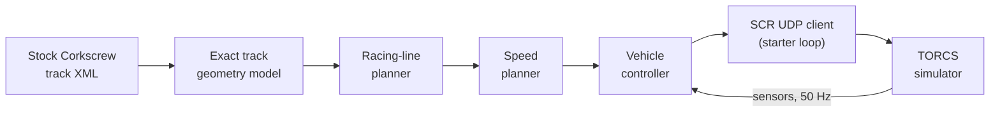
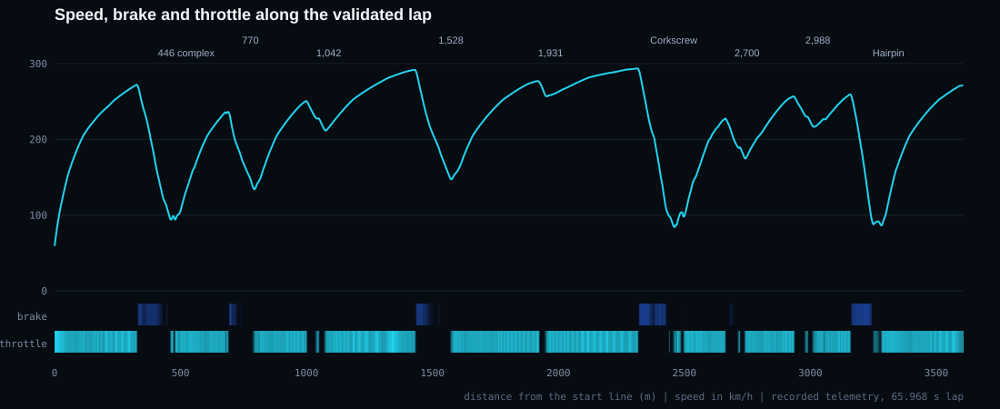
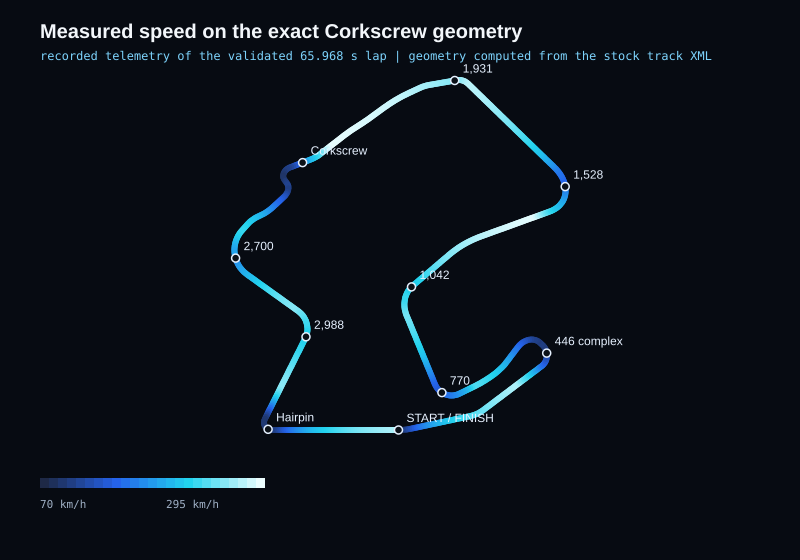

<p align="center">
  
</p>

# Autonomous Racing Controller for TORCS - Corkscrew

A deterministic Python driver for the IBM AI Racing League challenge: one standing-start lap of the **Corkscrew** circuit in the stock `car1-ow1` Formula-style car, on stock TORCS physics, with **zero damage**. The controller combines an exact model of the track geometry, planned racing line and speed profile, and a closed-loop vehicle controller (steering, braking, traction control, ABS, gearbox and launch). Its parameters were then tuned with a simulator-in-the-loop optimizer that scored every candidate by the official lap time.

| Lap time | Damage | SCR timeouts | Conditions |
|:--:|:--:|:--:|:--|
| **66.284 s** | **0** | **0** | Corkscrew, 1 lap, standing start, stock `car1-ow1`, 100 L fuel, stock physics, normal damage, original livery texture |

Verified in **five consecutive native Windows TORCS runs** (official result XML, simulator log and client log for each are in [`evidence/`](evidence/native_windows_validation/)); all five finished in exactly 66.284 s because TORCS is deterministic when the client answers every step on time.

---

## Qualifying lap

[](https://youtu.be/lp-c8A3NIJI)

**Official Qualifying Lap - Corkscrew Circuit - 66.284 Seconds**

The video is the author's recorded qualifying footage of the autonomous controller driving the TORCS run itself: https://youtu.be/lp-c8A3NIJI. The graphics elsewhere in this README are either drawn from recorded telemetry of the same lap (labelled *measured*) or are conceptual diagrams (labelled *conceptual*); they are not race footage.

---

## How it works

<p align="center"></p>



**Offline (when the controller starts)**

1. **Track model** - the stock track XML is read once, read-only. Straights and arcs (with radius changes) are integrated analytically, which closes the lap at 360.00 degrees; banking is taken from the XML. A coarser 3 m grid model of the same road turns only 347 degrees per lap, which is why the exact model matters.
2. **Racing line** - a minimum-curvature path inside the road, plus line offsets inside selected windows that were optimized in the simulator.
3. **Speed planning** - a point-mass friction model with axle-load transfer, aerodynamic downforce, banking and a demonstrated braking table gives the target speed along the line. The planner is stored as arrays (`plan_y2_4.npz`) so no optimization runs during the race.

**Online (every simulator step, 50 Hz)**

- **Steering** - a curvature command built from a look-ahead feed-forward, lateral and heading feedback (pole-placement gains), an understeer feed-forward table, a small integral term, sideslip counter-steer, spin recovery and a steering-rate limit. In the minimum-time windows (330-680 m and the hairpin) the error terms use the exact road heading and an identified steering response delay.
- **Speed and braking** - the speed target is the plan limited by a live curvature limit; braking pedal comes from the required deceleration with a short brake lead.
- **Traction control and ABS** - the rear over-speed limit shrinks with lateral load and grows with speed; front slip above 0.12 reduces the brake pedal.
- **Gearbox** - the lowest gear that stays under the rev limit (from car speed; from driven-wheel speed during the launch), with a dwell time and an up/down rev window.
- **Launch** - a small clutch command on the grid, a larger traction allowance until 163 km/h, and gear choice from wheel speed rather than car speed.
- **Timing safety** - the SCR server expects a reply every step. The driver freezes and disables Python garbage collection once before the race so that a collection pause cannot cost a server timeout (each timeout adds latency for the rest of the lap).

### What the telemetry shows

<p align="center"></p>

<p align="center"></p>

*Measured: recorded telemetry of the validated controller (identical actions to the five native runs), drawn on the track geometry computed from the stock XML.*

---

## Simulator-in-the-loop optimization

TORCS is deterministic as long as the controller answers every step on time (two runs of the same controller produced bit-identical action streams), and a lap is simulated faster than real time (about 3 s of wall time per lap in the optimization runner; 7-19 s per complete validation run including start-up). That makes the simulator itself an exact objective function.

- **Method** - a CMA-ES search per corner window over 10 variables (6 lateral-offset nodes of the line, 4 speed-target nodes), one real TORCS lap per candidate, ranked by the **official lap time**.
- **Hard constraints on every candidate** - zero damage, zero SCR timeouts, standing start, track position and sideslip limits, no spin recovery, and measured guards for the 1,931 m kerb (entry speed at most 272.5 km/h and top speed at most 278.0 km/h; damage appeared at 273.5 and 279.1 km/h).
- **Validation** - every accepted result was repeated on a second, independent client runner; the final package was validated through the starter client loop (`snakeoil3_gym.py`, unmodified).

*Development history (earlier milestones, not separate deliverables): each row is the best validated candidate after that step, all with the stock car; only the last row is the published controller.*

| Step (cumulative, stock car) | Official lap |
|---|---:|
| Starting point for this series | 66.906 s |
| 1,528 m corner window | 66.780 s |
| 770 m corner window | 66.686 s |
| 1,042 m corner window | 66.526 s |
| 2,700 m corner window | 66.506 s |
| 330-680 m complex (line and speed nodes) | 66.356 s |
| Launch settings (clutch, traction allowance) | **66.284 s** |

The hairpin window produced no feasible improvement (every faster candidate exceeded the sideslip limit), and planner-only changes (speed windows, a rebuilt line-and-speed window and a lateral-law swap at 1,528 m) were slower in the simulator and were rejected.

## Results and reproducibility

| Run | Start order | Official time | Damage | Timeouts |
|---|---|---:|---:|---:|
| `native_run1` | client first (see note) | 66.284 s | 0 | 0 |
| `native_run2` | client first (see note) | 66.284 s | 0 | 0 |
| `native_run3` | TORCS first | 66.284 s | 0 | 0 |
| `native_run4_state_diag` | TORCS first | 66.284 s | 0 | 0 |
| `native_run5_final` | TORCS first, final files | 66.284 s | 0 | 0 |

- **Fresh-clone check** ([evidence/fresh_clone_validation/](evidence/fresh_clone_validation/)): the repository copied outside the original project, run with `tools/validate_windows.py` and `TORCS_DIR` set - two clean runs at 66.284 s / damage 0 / 0 timeouts; the first attempt hit one SCR timeout while the PC was busy and finished in 67.058 s, which is exactly why a run with any timeout is not counted as a reproduction.
- *Note:* in `native_run1` and `native_run2` the controller was started about 1 s before TORCS, so the starter client printed its handshake countdown and reached its `relaunch torcs` branch (the `pkill`, `torcs` and `sh` commands it tries do not exist on Windows; see `client_stderr.txt`). The race itself was unaffected. The documented order is TORCS first, as in runs 3-5.
- `native_run4_state_diag` also records the first server state: lap time -0.982 s, speed 0, **fuel 100.0 L**, damage 0.
- The controller's actions are identical (SHA-256 over all 3,331 steps) between the development package and this repository's driver on recorded observations.
- **Reference hashes** of the stock files used in the runs are in [`tools/reference_hashes.json`](tools/reference_hashes.json); the controller files are listed with SHA-256 in [`controller/SHA256SUMS.txt`](controller/SHA256SUMS.txt).
- The published `official_result.xml` files differ from TORCS' originals only in the two header lines that carried local file paths; the original files' hashes are in [`ORIGINAL_RESULT_XML_SHA256.txt`](evidence/native_windows_validation/ORIGINAL_RESULT_XML_SHA256.txt).

**Honest limits.** Results are from the native Windows TORCS build supplied with the league (`wtorcs.exe`); they were not reproduced in the Linux container. A run with any server timeout is not a valid reproduction (a single timeout costs about 0.4 s). Lap times are exact only when the stock files match the reference hashes.

**Historical results.** `livery/README.md` was written for an earlier development version and mentions a 67.064-second result: that was a different controller on a modified car setup, **not** the published controller and not a valid result under the stock conditions above. The published result is 66.284 s.

---

## Livery

- **Original livery (used for every validated run and all evidence):** the league's stock `drivers/scr_server/0/car1-ow1.rgb` texture, SHA-256 `6756554d9b9ec53e11cdc6dd549069ddabf930071a7699184e6364361a25d54f` (listed in [`tools/reference_hashes.json`](tools/reference_hashes.json)). It is a TORCS asset and is not included in this repository.
- **Custom livery "Apex Noir 07" (`livery/`):** a separate, optional design. Its texture `livery/car1-ow1.rgb` (SHA-256 `d7ce24004fdae48f3331f28ede8fa8218f899418829786934983cad25080a72a`) is a different file and was **not** used for the validated runs or the evidence in this repository. It changes appearance only; if you install it, `tools/validate_windows.py` reports the livery hash difference as a warning.

## Run it on Windows

Full guide: [`docs/WINDOWS_RUN.md`](docs/WINDOWS_RUN.md). Summary:

0. Get the code and verify it (PowerShell). Use `core.autocrlf=false` so the files stay byte-exact (the repository also ships a `.gitattributes` for this):
   ```powershell
   git clone -c core.autocrlf=false https://github.com/youssefabdelkariem/IBM-AI-Racing-League.git
   cd IBM-AI-Racing-League\controller
   Get-Content SHA256SUMS.txt | ForEach-Object { $h, $f = $_ -split '\s+', 2; if ((Get-FileHash $f -Algorithm SHA256).Hash.ToLower() -eq $h) { "OK    $f" } else { "DIFF  $f" } }
   ```
   All 11 lines must print `OK`.
1. Use your existing league TORCS install (the folder with `wtorcs.exe`). Python 3.9+ and numpy: `python -m pip install -r requirements.txt`.
2. Point the controller at the install (read-only access to the stock Corkscrew XML):
   ```powershell
   $env:TORCS_DIR = 'C:\path\to\torcs'
   ```
3. Start TORCS: Race, Quick Race, Configure Race: Road, **Corkscrew**, only `scr_server 1`, **1 lap**; click **New Race** (waiting screen).
4. Start the controller (no extra arguments) from the repository root:
   ```powershell
   cd controller
   python -B run_controller.py
   ```
   Expected: `Client connected on 3001..............` and, at the end, `Server has stopped the race on 3001. You were in 1 place.`
5. Read the official time and damage in the newest `results\quickrace\results-*.xml` in the TORCS folder.

Optional one-command check (starts TORCS, then the controller, and records everything): `python tools/validate_windows.py my_run` with `TORCS_DIR` set. It prints a verdict - `REPRODUCED` (valid run at 66.284 s), `VALID_RUN_DIFFERENT_TIME` or `INVALID_RUN` (any timeout, damage or client error) - and returns a matching exit code. `--check-only` only verifies the paths; `--selftest` re-checks the acceptance logic offline against the published evidence.

## Repository structure

```
README.md                    this file
assets/                      banner, architecture diagram (conceptual), measured speed profile and speed map
controller/                  everything needed to drive (run from here)
  run_controller.py          entry point: the starter client loop with our driver
  submission_driver.py       loads settings, drives, guards against GC pauses
  controller_c3.py           steering, speed, braking, traction, ABS, gearbox, launch
  c1_plan.py, c3_geom.py, c3_model.py   track geometry, line and speed planning, vehicle model
  plan_y2_4.npz, line_4.4.npz, line_4.9.npz, settings.json   optimized plan and accepted settings
  snakeoil3_gym.py           unmodified starter SCR client (MIT, see THIRD_PARTY_NOTICES.md)
  SHA256SUMS.txt             checksums of all controller files
docs/WINDOWS_RUN.md          step-by-step Windows instructions, stop/restart, troubleshooting
evidence/                    native Windows validation runs, measured speed profile data
livery/                      separate custom livery "Apex Noir 07" (optional, not used for the validated runs)
licenses/                    third-party licence text
tools/                       validate_windows.py (one-command run, offline selftest), reference_hashes.json
.gitattributes               keeps controller files byte-exact when cloned on Windows
requirements.txt             numpy
```

## Acknowledgments and licensing

- **TORCS** (The Open Racing Car Simulator) and the league-provided SCR server, car and track. No TORCS asset is included here (the controller reads the stock track XML from your install); no licence is granted for TORCS assets.
- **gym_torcs / Snake Oil** SCR client: `controller/snakeoil3_gym.py` is the unmodified starter file (gym_torcs by Naoto Yoshida, MIT; Snake Oil client by Chris X Edwards). See [`THIRD_PARTY_NOTICES.md`](THIRD_PARTY_NOTICES.md) and `licenses/`.
- **IBM AI Racing League** and IBM SkillsBuild, built for the league.
- Developed and maintained by [@youssefabdelkariem](https://github.com/youssefabdelkariem) with AI-assisted engineering tools; the competition's tool disclosure is provided separately. No open-source licence has been selected yet for the project's own code.

