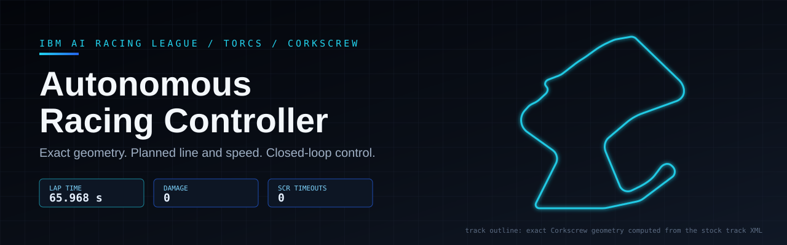
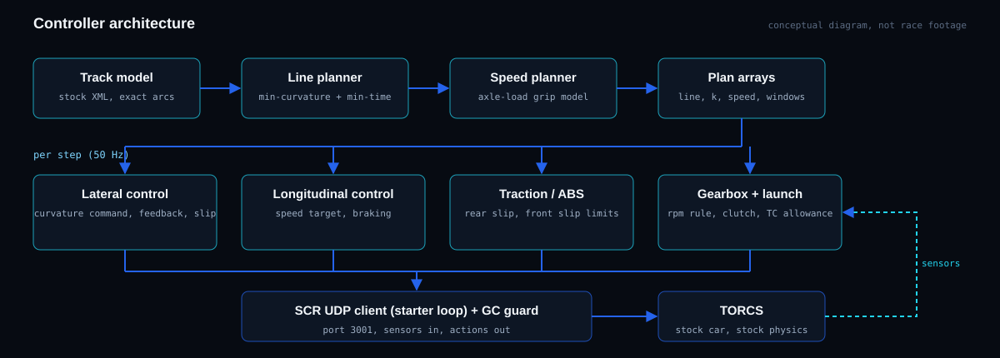
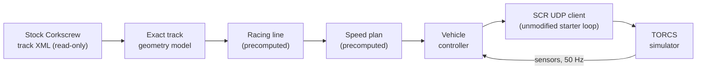

<p align="center">
  
</p>

**Portfolio:** [youssef.studio](https://youssef.studio) — Explore more of my projects, technical work, and creative portfolio.

Project write-up: [youssef.studio/engineering/ibm-ai-racing](https://youssef.studio/engineering/ibm-ai-racing/) (at the time of writing it describes the earlier 66.284 s version).

# Autonomous Racing Controller for TORCS - Corkscrew

A deterministic Python driver for the IBM AI Racing League: one standing-start lap of the **Corkscrew** circuit in the stock `car1-ow1` car, with stock TORCS physics and **zero damage**. It talks to TORCS through the standard SCR client interface. At start-up it builds an exact model of the road from the stock track file, then follows a precomputed racing line and speed plan with closed-loop control of steering, throttle, brake, traction, ABS, gears and clutch.

This branch contains release **P1**:

| Lap time | Damage | SCR timeouts | Conditions |
|:--:|:--:|:--:|:--|
| **65.968 s** (result screen `01:05:96`) | **0** | **0** | Corkscrew, Quick Race, 1 lap, standing start, stock `car1-ow1`, stock physics, original livery, native Windows TORCS |

All validation runs of this exact `controller/` folder finished in exactly 65.968 s. TORCS is deterministic when the client answers every step on time. Evidence is in [`evidence/release_p1_65968/`](evidence/release_p1_65968/).

> These are **locally validated results** on the author's machine. They are not official league times or rankings; the organisers have not verified them.

---

## Contents
- [Results and progression](#results-and-progression)
- [Architecture](#architecture)
- [Racing line](#racing-line)
- [Steering](#steering-control)
- [Speed and braking](#speed-and-braking)
- [Traction control and ABS](#traction-control-and-abs)
- [Gears and clutch](#gears-and-clutch)
- [Optimisation method](#optimisation-method)
- [Testing and validation](#testing-and-validation)
- [Install and run](#install-and-run)
- [Repository structure](#repository-structure)
- [Compliance notes](#compliance-notes)
- [AI tool disclosure](#ai-tool-disclosure)
- [Acknowledgments and licensing](#acknowledgments-and-licensing)
- [More about my work](#more-about-my-work)

---

## Results and progression

All laps were run with the stock car, track and physics, a standing start and zero damage.

| Version | Lap (s) | Change from the previous version |
|---|---:|---|
| Previous release (original submission package) | 66.284 | - |
| Finish-line fix | 66.262 | A speed look-ahead read the standing-start speed cap at the end of the lap and braked for the line. The look-ahead is now clamped to the last plan sample. |
| Traction control and ABS tuning | 66.020 | Looser traction control and earlier ABS release: about 0.55 s more full throttle and 0.39 s less braking per lap. |
| **Corkscrew line (P1, this release)** | **65.968** | Straighter line through the left-right direction change at 2,301-2,493 m. Peak sideslip there fell from 14.4° to 9.4°, and minimum speed rose by 4.3 km/h. |

All times are local validation results (native Windows TORCS, official result XML, 0 server timeouts), not official rankings.

A later study of the 770 m corner found no reliable further gain, so P1 was kept unchanged. Earlier development steps (66.906 → 66.284 s) are summarised in [`docs/TECHNICAL.md`](docs/TECHNICAL.md#performance-history).

### Lap recording (65.968 s) - pending publication
A new recording of the P1 lap was made with the same controller files, race configuration and stock car.
- **Result:** 65.968 s (`01:05:96`), damage 0, 0 server timeouts; stock files hash-checked before and after the race.
- **Capture:** the TORCS window only, rendered natively at 1920×1080 and recorded at 60 fps with OBS window capture. No desktop, taskbar, cursor or file paths appear.
- **Content:** the grid ("Ready"), the standing start, the complete lap with the timer, damage, speed and rpm read-outs visible throughout, and 5 s of the TORCS results screen.

There are two exports:
- a **clean qualifying version** (unedited race footage only);
- a **YouTube version** with a short title card before the start and a credit card after the results. The race footage itself is not altered.

**The video has not been uploaded yet; a link will be added here once it is public.** Video files are not stored in this repository.

**Historical:** the recording below shows the **previous 66.284 s release**, not P1.

[](https://youtu.be/lp-c8A3NIJI)

---

## Architecture

<p align="center"></p>



| Prepared at start-up, before the car moves | Decided live, every 20 ms step |
|---|---|
| Road geometry from the stock, unmodified Corkscrew track file: centre-line curvature, heading, grade, banking | Steering angle |
| Racing line: lateral offset from the centre line along the lap (`plan_cand.npz`, `line_4.4.npz`) | Throttle and brake |
| Speed plan along that line (`plan_cand.npz`) | Gear and clutch |
| Controller parameters (`settings.json`) | All corrections: path, heading and yaw-rate errors, sideslip, wheel slip, edge and grip limits |

During the race the controller reads only standard SCR sensors: `distFromStart`, `speedX/Y`, `angle`, `trackPos`, `wheelSpinVel`, `rpm`, `gear` and `curLapTime`. It sends only standard SCR commands: `steer`, `accel`, `brake`, `gear` and `clutch`.

It does **not** replay recorded actions. The line and speed plan are references that feedback controllers track and correct in real time.

| File (`controller/`) | Role |
|---|---|
| `run_controller.py` | Entry point. Runs the starter loop of `snakeoil3_gym.py` (`Client(p=3001)` → `get_servers_input` → `drive` → `respond_to_server`). |
| `snakeoil3_gym.py` | Unmodified starter SCR client. |
| `submission_driver.py` | Loads `settings.json` and freezes and disables Python's garbage collector for the race. |
| `controller_c3.py` | Steering, speed, braking, traction control, ABS, gears and clutch. |
| `c1_plan.py`, `c3_geom.py` | Read the stock track XML and build the exact geometry and reference. |
| `plan_cand.npz` | Precomputed racing line and speed plan for Corkscrew. |
| `line_4.4.npz`, `line_4.9.npz` | Minimum-curvature line caches. The 4.4 m cache is used. The 4.9 m cache is the import-time default; shipping it stops the controller writing a cache file at start-up. |
| `settings.json` | Controller parameters (frozen). |

## Racing line
1. **Minimum-curvature base line.** The line stays within ±4.4 m of the centre line (road half-width 6 m). It is found by Levenberg-Marquardt minimisation of squared path curvature.
2. **Exact-geometry windows.** In the 330-680 m complex and the hairpin, line and curvature are rebuilt on the exact track geometry, integrated analytically per track segment. A model-based minimum-time speed plan is used in these windows.
3. **Local offsets from simulator-in-the-loop search.** Seven windows carry offsets, typically 0.1-1.0 m: 446 m, 770 m, 1,042 m, 1,528 m, 2,700 m, the hairpin, and the Corkscrew (2,301-2,493 m, new in P1). Curvature is always recomputed from the offset line, so the steering feed-forward stays consistent.

The exact model matters: integrating the XML's straights and arcs closes the lap at 360.00°, while a 3 m grid model of the same road turns only 347°.

## Steering control
At every step the controller computes lateral and heading error against the planned line. Heading is based on the car's direction of travel, so sideslip is included. The steering command combines:
- **Curvature feed-forward:** the planned curvature a short time ahead, with 0.28 s look-ahead (0.07 s in the exact-geometry windows, matching the measured steering response delay);
- **Path feedback** on lateral and heading error (pole placement on the path-error dynamics);
- a **PI loop on measured path curvature** from the yaw rate;
- an **understeer compensation** map.

Safety layers:
- counter-steer proportional to sideslip;
- **spin recovery**, which blends the wheels towards the velocity direction above 8.6° of sideslip;
- a steering lock cap and a steering rate limit.

## Speed and braking
- **Target speed:** the plan speed a short look-ahead ahead, lowered live when needed:
  - a **grip limiter** reduces it when the demanded curvature exceeds the tyre-grip estimate at the current speed;
  - **path-error and track-edge guards** slow the car when it is far off its line or near the edge.
- A **speed law** converts plan acceleration and speed error into throttle or brake. It covers engine braking, drag and grade, and rate-limits both pedals.
- **Standing start:** full throttle to the line, a launch clutch setting, and a higher wheel-slip allowance during the launch phase.

## Traction control and ABS

**Traction control** compares rear over-speed (driven-wheel speed minus car speed) with a threshold:
- 5.30 m/s on straights;
- 3.11 m/s at full cornering load;
- raised with speed above 24.9 m/s.

Above the threshold the throttle is cut proportionally over a 4.84 m/s band.

**ABS:** while braking above 8 m/s, if front slip ratio exceeds 0.05, the brake pedal is reduced proportionally, never below 30 %.

## Gears and clutch
- **Gears:** the lowest gear that keeps the speed-derived rpm below the limit, with up/down thresholds and a minimum time between shifts. The lowest gear while moving is 2nd.
- **Clutch:** besides the launch, the clutch is partly opened while accelerating at low driven-axle rpm and for 3 steps after each shift. This uses the standard SCR clutch command. It relies on TORCS's clutch model, which passes full torque at about one-third engagement (see [Compliance notes](#compliance-notes)).
- **Timing safety:** the SCR server expects a reply every step. If a reply is late, the server reuses the previous command ("Timeout for client answer"), which changes the lap by about 0.4 s. `submission_driver.py` runs `gc.collect()`, `gc.freeze()` and `gc.disable()` once before the race, so no collector pause can cause a timeout.

## Optimisation method
TORCS is deterministic: identical settings give bit-identical laps when no server timeout occurs. One full lap is therefore an exact evaluation, taking about 7 s of wall time in results-only mode.

- **Simulator-in-the-loop search.** Every candidate is a real TORCS lap, ranked by the official lap time. Methods: CMA-ES (covariance-matrix adaptation), one-at-a-time screening and structured local refinement.
- **Hard constraints on every candidate:**
  - complete lap, zero damage, zero server timeouts, car on track;
  - at most 0.73 of the half-width in the 446 m complex;
  - kerb guards at 1,931 m: entry speed ≤ 272.5 km/h and top speed ≤ 278.0 km/h (damage was measured at 273.5 and 279.1 km/h);
  - a sideslip cap and per-corner edge-clearance limits.
- **Independent validation.** Each accepted change was rebuilt from its saved files and raced repeatedly through the unmodified entry point, interleaved with the previous best. It was also run in graphics mode while screen recording.

Details and per-step history: [`docs/TECHNICAL.md`](docs/TECHNICAL.md).

## Testing and validation

| Check | Result |
|---|---|
| `controller/SHA256SUMS.txt` | 12/12 OK. The folder is byte-identical to the sealed P1 release package. |
| Imports through the entry point | Every project module loads from `controller/`. No cache file is written at start-up. |
| Track file resolution | The stock `corkscrew.xml`, found via `TORCS_DIR` (SHA-256 in [`tools/reference_hashes.json`](tools/reference_hashes.json)). |
| Replay identity | All 3,241 logged states of a P1 reference lap were fed to this folder's driver. Steer, throttle, brake, gear and clutch commands matched exactly (0 mismatches). |
| Native TORCS, this repository (`tools/validate_windows.py`) | **5/5 runs: 65.968 s, 1 lap, damage 0, 0 timeouts, verdict `REPRODUCED`.** Nine stock files (car, livery, track, Quick Race configuration, category, race engine, physics DLL, SCR server DLL, `wtorcs.exe`) were hash-checked before and after every race and never changed. |
| Native TORCS, sealed release package | 6/6 runs at 65.968 s plus one graphics-mode race recorded with OBS at 65.968 s; damage 0 and 0 timeouts in all. |
| Track limits (logged run of the release package) | Max \|trackPos\| 0.967 (on track); 446 complex 0.721 (limit 0.73); kerb entry 271.7 km/h (guard 272.5); kerb top speed 276.9 km/h (guard 278.0); peak sideslip 13.6°. |
| Earlier P1 runs | 10 identical laps in the line study (4 in graphics/OBS mode) and 12 in the later 770 m study. |
| `tools/validate_windows.py --selftest` | PASSED (re-evaluates the published evidence offline). |

Limits:
- Results come from the native Windows TORCS build supplied with the league (`wtorcs.exe`). They have not been reproduced in the Linux container.
- A run with any server timeout is not a valid reproduction.
- Lap times are exact only when the stock files match the reference hashes.

## Install and run

Full guide: [`docs/WINDOWS_RUN.md`](docs/WINDOWS_RUN.md).

1. **Clone and verify** (PowerShell). Keep line endings byte-exact; the repository also ships a `.gitattributes` for this.
   ```powershell
   git clone -c core.autocrlf=false https://github.com/youssefabdelkariem/IBM-AI-Racing-League.git
   cd IBM-AI-Racing-League\controller
   Get-Content SHA256SUMS.txt | ForEach-Object { $h, $f = $_ -split '\s+', 2; if ((Get-FileHash $f -Algorithm SHA256).Hash.ToLower() -eq $h) { "OK    $f" } else { "DIFF  $f" } }
   ```
   All 12 lines must print `OK`.
2. **Install prerequisites.** You need the league's TORCS install (the folder containing `wtorcs.exe`), and Python 3.9+ with numpy (tested with Python 3.9.13 and numpy 2.0.2): `python -m pip install -r requirements.txt`.
3. **Point the controller at TORCS** so it can read the stock track XML (read-only):
   ```powershell
   $env:TORCS_DIR = 'C:\path\to\torcs'
   ```
4. **Set up the race in TORCS:** Race → Quick Race → Configure Race. Choose Road, **Corkscrew**, only `scr_server 1`, **1 lap**. Then click **New Race**; TORCS waits for the client on UDP 3001.
5. **Start the controller** with no arguments:
   ```powershell
   cd controller
   python -B run_controller.py
   ```
   Expected output: `Client connected on 3001..............`, then, at the end, `Server has stopped the race on 3001. You were in 1 place.`
6. **Read the result:** the official time and damage are in the newest `results\quickrace\results-*.xml` in the TORCS folder.

**One-command check:** with `TORCS_DIR` set, run `python tools/validate_windows.py my_run`. It starts TORCS, then the controller, records the logs and prints a verdict:
- `REPRODUCED`: a valid run at 65.968 s;
- `VALID_RUN_DIFFERENT_TIME`;
- `INVALID_RUN`: any timeout, damage or client error.

`--check-only` only verifies paths; `--selftest` re-checks the acceptance logic offline.

Run nothing CPU-heavy during a race.

## Repository structure

```
README.md                    this file
assets/                      banner, architecture diagram (conceptual), measured speed profile and speed map (P1 lap)
controller/                  the complete P1 release package; run from here
  run_controller.py          entry point: the starter client loop with our driver
  submission_driver.py       loads settings, drives, guards against GC pauses
  controller_c3.py           steering, speed, braking, traction control, ABS, gears, clutch
  c1_plan.py, c3_geom.py     stock track geometry (read-only) and reference construction
  plan_cand.npz              precomputed racing line and speed plan
  line_4.4.npz, line_4.9.npz minimum-curvature line caches
  settings.json              controller parameters
  snakeoil3_gym.py           unmodified starter SCR client (MIT, see THIRD_PARTY_NOTICES.md)
  README.md, requirements.txt, SHA256SUMS.txt   package notes, dependency, checksums of every file
docs/
  WINDOWS_RUN.md             step-by-step Windows instructions, stop/restart, troubleshooting
  TECHNICAL.md               technical documentation and performance history
  COMPLIANCE.md              rule review and open questions for the organisers
  AI_TOOL_DISCLOSURE.md      AI tools used and what they did
evidence/
  release_p1_65968/          native validation of this release (sanitised result XML, logs, reports)
  lap_speed_profile.json     measured speed along the P1 lap (data for the graphics)
  release_66284/             evidence of the previous 66.284 s release (kept for history)
livery/                      the original, unmodified livery texture (car1-ow1.rgb)
licenses/                    third-party licence text
tools/                       validate_windows.py (one-command run, offline selftest), reference_hashes.json
.gitattributes               keeps files byte-exact when cloned on Windows
requirements.txt             numpy
```

## Compliance notes
The following conditions are met and verified (see [`docs/COMPLIANCE.md`](docs/COMPLIANCE.md)):
- standing start;
- Corkscrew, 1 lap;
- zero damage;
- stock car, livery, physics and track: hash-identical before and after every race;
- only Python controller code and its own data files were changed.

**Open points for the organisers.** These are not confirmed and are **not** approvals; the written questions are in `docs/COMPLIANCE.md`:
1. Reading the stock track file at start-up, and shipping a precomputed racing line and speed plan.
2. Partial clutch use during acceleration. This is a standard SCR command, but it uses the TORCS clutch model described above.
3. A separate entry script (`run_controller.py`) instead of editing `torcs_jm_par.py`.
4. The exact deadline and submission form.
5. Validation on the supplied native Windows TORCS build rather than the Linux container.

## AI tool disclosure
This controller was developed with substantial help from AI coding tools; the details are in [`docs/AI_TOOL_DISCLOSURE.md`](docs/AI_TOOL_DISCLOSURE.md).

| Tool | What it was used for |
|---|---|
| **IBM Bob** | Early controller versions V2-V5: first speed controllers, safety and recovery logic, wheel-slip traction control, gear anti-hunting, predictive braking. The final controller does not use that code. |
| **OpenAI Codex** | Audit of the starter controller and track geometry; early stock-car controllers (best 80.726 s); stock-car restoration and hash verification; review of a public competitor's code and an unmodified local benchmark run. |
| **Claude Code** (Anthropic) | The controller line used in this entry, plus the optimisation, validation, packaging and documentation of releases 66.284 s and P1 (65.968 s). |
| **IBM Granite** | Not used to develop, tune or validate this controller; no project record documents such use. |

The author set the objectives and constraints, approved each phase and decides what is submitted.

A public competitor driver ([AdrianoNTorres/IBM-AI-RACE-CHALLENGE](https://github.com/AdrianoNTorres/IBM-AI-RACE-CHALLENGE)) was run unmodified, locally, only as a performance reference. **None of its code, tables or parameters are used here.**

## Acknowledgments and licensing
- **TORCS** (The Open Racing Car Simulator) and the league-provided SCR server, car and track. No TORCS asset is included here: the controller reads the stock track XML from your install, and no licence is granted for TORCS assets.
- **gym_torcs / Snake Oil** SCR client: `controller/snakeoil3_gym.py` is the unmodified starter file (gym_torcs by Naoto Yoshida, MIT; Snake Oil client by Chris X Edwards). See [`THIRD_PARTY_NOTICES.md`](THIRD_PARTY_NOTICES.md) and `licenses/`.
- Built for the **IBM AI Racing League** and IBM SkillsBuild.
- Developed and maintained by [@youssefabdelkariem](https://github.com/youssefabdelkariem). No open-source licence has been selected yet for the project's own code.

## More About My Work

For more projects, technical experiments, 3D/VFX work, and interactive project breakdowns, visit my portfolio:

**[youssef.studio](https://youssef.studio)**
